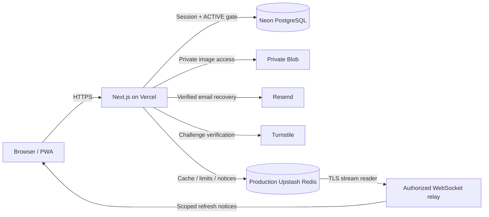

<p align="center"></p>

<h1 align="center">IMS Network</h1>
<p align="center"><strong>Connect with your ESITH IMS alumni community.</strong></p>
<p align="center">
  <a href="https://ims-network.vercel.app">Live application</a> ·
  <a href="https://github.com/hicham-4r/ims-network/releases/tag/v1.0.0">v1.0.0 release</a> ·
  <a href="docs/architecture/overview.md">Architecture</a> ·
  <a href="docs/phase26-release-evidence.md">Release evidence</a>
</p>

---

IMS Network is an independent, non-commercial professional networking platform for graduates of the IMS program at ESITH in Morocco. It brings professional discovery, private conversations and community administration together in a responsive, installable web application.

Designed and developed by [hicham-4r](https://github.com/hicham-4r). The initial public release went live on **28 November 2026**. The landing page and registration are public; the network itself is restricted to approved members.

## Product highlights

| Community | Communication | Account & security |
| --- | --- | --- |
| Searchable alumni directory | Private realtime messaging | Admin-approved membership |
| Professional profiles and skills | Replies and emoji reactions | Authenticated password changes |
| Mentorship availability | Sent, delivered and read states | Email recovery for verified addresses |
| Private profile pictures | Opt-in typing and recent activity | Single-use member recovery codes |
| Responsive layout and themes | Incoming-message history | Data export and manual deletion requests |

Owner-controlled moderation, audit history, a keyboard-accessible command palette and an installable PWA complete the experience. Offline navigation shows a fallback rather than storing private conversations.

## Architecture



PostgreSQL is the durable source of truth. Redis is an ephemeral cache, rate limiter and change-notice transport, not a second message database. Production has dedicated Redis; protected Preview uses its own PostgreSQL rate limiter and does not access Redis. See the [architecture](docs/architecture/overview.md) and [environment guide](docs/phase23-environments.md).

| Layer | Technology |
| --- | --- |
| Web | Next.js 16, React 19, TypeScript, Tailwind CSS, shadcn/ui |
| Identity | Better Auth, Zod, Cloudflare Turnstile |
| Data | Neon PostgreSQL, Drizzle ORM |
| Realtime | Redis Streams, ioredis over TLS, WebSockets |
| Media and email | Private Vercel Blob, Resend |
| Delivery | Vercel, GitHub Actions, npm lockfile |

## Engineering evidence

| Trial | Observed result | Scope |
| --- | --- | --- |
| Authenticated HTTP baseline | 300/300 successful reads; p50 1,172 ms, p95 2,289 ms | 100 distinct accounts, three waves |
| Realtime readiness | 100/100 sockets ready; overlap 60.076 s; p95 1,745 ms | Historical protected Preview stress trial |
| Public launch and PWA | 17/17 maintainer-reported checks passed | Initial Production release |

These are scoped historical test results, not an uptime or capacity guarantee. The project targets free-tier infrastructure and avoids idle presence polling, unbounded history reads and unnecessary deployment builds. See [performance evidence](docs/phase23-performance-evidence.md) and [release evidence](docs/phase26-release-evidence.md) for context and limitations.

## Local development

Use Node.js **26.13.0** (the version pinned in CI), npm and the committed lockfile. Inspect dependency advisories before installing. Configure isolated Development services using `.env.example` as a template; keep real values in local ignored files. Never use Production credentials in Development or CI.

```bash
npm ci --no-audit --no-fund
node node_modules/next/dist/bin/next typegen
node tools/ci/validate.cjs
node tools/ci/check-migrations.cjs --exact
```

For runtime work, configure a database with the reviewed schema, then use `npm run dev`. Some abuse-sensitive operations intentionally fail closed without an authorized limiter; use protected Preview for integrated validation. Run `npm run build` in a reviewed non-Production environment before runtime releases. See the [development workflow](docs/development-workflow.md).

CI runs structural, mocked and typed regressions, migration-content checks, TypeScript and zero-warning ESLint. It does not run cloud mutations, live acceptance or automatic deployments. Review `npm audit` separately; never force-fix dependencies without checking compatibility.

## Documentation

| Guide | Contents |
| --- | --- |
| [Member guide](docs/member-guide.md) | Joining, messaging, security, privacy and installation |
| [Architecture](docs/architecture/overview.md) | Trust boundaries, message lifecycle, deployment topology |
| [Data model](docs/data-model.md) | Schema and historical design notes |
| [Environment configuration](docs/phase23-environments.md) | Isolated services and flags |
| [Development workflow](docs/development-workflow.md) | Local checks, Git and migration safety |
| [Release and operations](docs/phase23-release-runbook.md) | CI, deploys, rollback and incidents |
| [Release evidence](docs/phase26-release-evidence.md) | Launch acceptance, limitations and follow-up |
| [Performance evidence](docs/phase23-performance-evidence.md) | Historical tests and resource baseline |
| [Portfolio case study](docs/phase23-portfolio.md) | Design decisions and engineering trade-offs |
| [ADRs](docs/adr/) | Decision history |

## Author and copyright

Copyright © 2026 [hicham-4r](https://github.com/hicham-4r). All rights reserved in original project material, subject to applicable law and third-party licenses. See [COPYRIGHT.md](COPYRIGHT.md). No open-source license has been selected for the original project. Third-party components remain subject to their own licenses.

IMS Network is an independent project; no official endorsement by ESITH or any infrastructure provider is implied.
