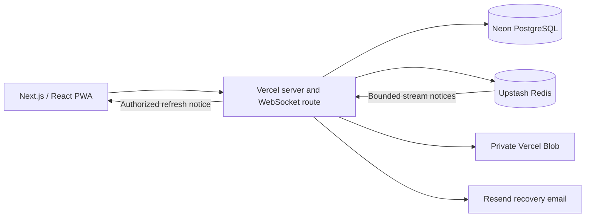

# IMS Network

A private professional alumni network for the IMS program at ESITH, Morocco. Built as a full-stack engineering project with a secure membership model, responsive interface and budget-aware real-time messaging.

**Status:** protected Preview accepted by the project maintainer after Phase 22; Production not launched. CI quality workflow is included in Phase 23 and must pass on GitHub before it is described as operational.

## Product

- Administrator-approved membership, email/password sessions, recovery and account controls. Mandatory email-address verification was deliberately removed; administrative approval remains required.
- Searchable alumni directory with private avatars, professional fields, skills and mentorship availability.
- Direct messaging with optimistic sends, idempotent retries, replies, reactions, read/delivery status and bounded real-time refresh notices.
- Opt-in recent conversation activity and typing; incoming-message notification history (not global push notifications).
- Owner-managed review-only moderator capability, message reports and administrative audit trail.
- Responsive charcoal/blue design, light/dark/system themes, keyboard navigation, reduced-motion support and privacy-safe PWA fallback.

## Architecture



Next.js App Router, TypeScript, React, Tailwind CSS, shadcn/ui, Better Auth, Drizzle ORM, Zod, Upstash Redis (REST + TLS TCP reader), Vercel Blob and Resend. PostgreSQL is authoritative; Redis is ephemeral coordination, caching and rate limiting. Sessions and private responses are never shared in public caches.

## Engineering evidence

| Trial | Observed result | Scope |
| --- | --- | --- |
| Phase 21 HTTP baseline | 300/300 successful reads; p50 1172 ms, p95 2289 ms | Three waves, 100 authenticated accounts; not sustained load |
| Phase 21 socket trial | 100/100 authenticated sockets, 100 confirmed overlap for 60 s; p95 readiness 1745 ms | Protected Preview, 2026-11-26; not a monthly capacity guarantee |
| Phase 22 | Offline regressions, local typecheck/lint and Preview functionality accepted by maintainer | User-reported results; independent final release checks pending |

See [engineering evidence](docs/phase23-performance-evidence.md) for scope and limitations. No fabricated uptime, Lighthouse score or production usage statistics.

## Development and verification

Use Node.js 26.13.0 (the tested local version), npm and the lockfile. Install with `npm ci --no-audit --no-fund` after reviewing dependencies. Configure isolated Development services using the [environment checklist](docs/phase23-environments.md). Never copy credentials into Git.

```sh
node tools/ci/validate.cjs
node tools/ci/check-repository.cjs --staged
npm audit --audit-level=high
```

The quality runner executes reviewed structural and mock tests, migration-content checks, TypeScript and zero-warning ESLint. Historical copied CommonJS fixtures have narrowly scoped lint exceptions for require imports, unused fixture bindings and const style; application lint rules are unchanged. It intentionally does not run live provider tests, migrations or deployments. The repository guard is heuristic, not comprehensive secret scanning. The npm audit queries the package registry and requires manual review of findings; do not use automatic force fixes.

For runtime development, the configured database must match the application schema. The current Development database may still be on an older schema; use protected Preview for runtime validation until explicitly migrated. See the [release runbook](docs/phase23-release-runbook.md).

## Documentation

- [Architecture and trust boundaries](docs/architecture/overview.md)
- [Development workflow](docs/development-workflow.md)
- [CI and release process](docs/phase23-release-runbook.md)
- [Environment configuration](docs/phase23-environments.md)
- [Cost and performance evidence](docs/phase23-performance-evidence.md)
- [Portfolio case study and screenshot guide](docs/phase23-portfolio.md)
- [Security decisions](docs/adr/)
- [Community upgrade semantics](docs/phase22-community-upgrade.md)

Production data, account details and credentials are not part of the portfolio. License not selected; no institutional endorsement is implied.
