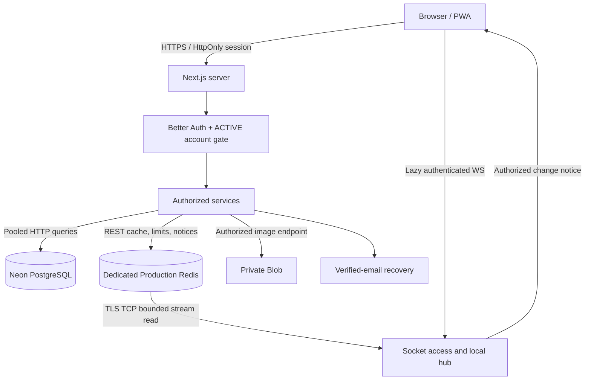
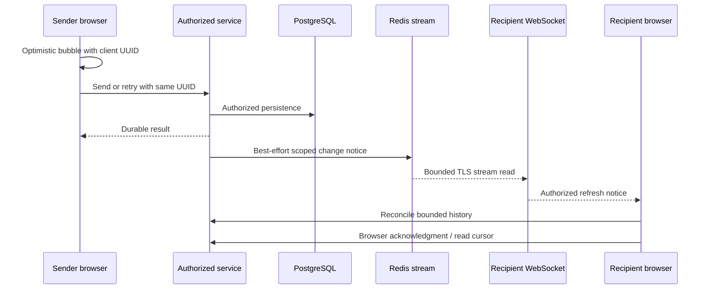

# Architecture — v1.0.0

Initial Production release: 28 November 2026. Historical ADRs record decisions as they were made; current source and this release overview describe the shipped topology.

## Components and trust boundaries

Identity comes from server sessions, not caller-supplied user IDs. Registration creates a pending account without mandatory email verification. An admin must independently establish eligibility before approval; email possession is not inferred from signup. Member routes and mutations require ACTIVE status. The configured owner is protected; moderator capability is separate from ADMIN, review-only and excludes private message bodies. Reviewer conflict-of-interest restrictions and audit events remain enforced.

The password-change service uses Better Auth verification/hashing and rechecks the account, live session and credential under PostgreSQL locks. The update revokes all stored sessions, invalidates the prior recovery code and records an audit event atomically. Email reset is limited to previously verified addresses. Eligible ordinary members can use single-use recovery codes; owner recovery codes are intentionally unavailable. No claim is made that all native sign-in/reset races are serialized. Revoked sockets are checked before outbound notices and have a bounded lease, not an instantaneous global disconnect guarantee.

## Persistence and caching

PostgreSQL stores users, sessions, credentials, profiles, conversations, messages, read cursors, delivery acknowledgments, moderation and audit records. The runtime uses pooled Neon HTTP queries; migrations use the direct connection. The nine applied migrations, journal and snapshots are immutable historical artifacts.

React request-scoped cache deduplicates authorization reads within a request. Session lookup starts at a request-time boundary (`connection()`); session cookie caching is disabled. Better Auth logging maps warning/error levels to sanitized events rather than raw provider exceptions. Member-detail cache uses profile revision and a fresh ACTIVE authorization check. Lists are bounded and paginated. Avatars are delivered through an authorized endpoint backed by private Blob. Private authenticated responses are not shared in public caches or stored by the PWA service worker.

## Message lifecycle

Persistence survives failed relay publication. The client reconciles missed notices and retries idempotently. RESP2, verified TLS and the tested TCP options must be preserved. Production uses a 150-second relay lease. One lazy socket per active messaging tab, not one per conversation or one per logged-in user. No idle heartbeat. Recent activity and typing are opt-in, conversation-scoped and time-limited; neither is global presence. Sent means persisted; Delivered means recipient-browser acknowledgment, not universal delivery; Read reflects a stored cursor. Notifications are incoming-message history, not a global push service.

## Environments

| | Development | Protected Preview | Production |
| --- | --- | --- | --- |
| Neon | Isolated | Isolated, pinned host for limiter | Fresh isolated database |
| Redis | Prohibited | Prohibited | Dedicated, explicit activation |
| Mutation limits | Fail closed if no allowed backend | PostgreSQL limiter | Redis |
| Realtime relay | Off | Off; refresh manually | Enabled |
| Blob | Separate private store | Separate private store | Separate private store |
| Access | Local | Vercel authentication | Public canonical domain; member routes protected |

Production uses the `ims-network:v1:production` namespace. The Redis isolation flag represents verified operator action, not proof by itself. Do not copy credentials across environments. Git-triggered deployment is disabled in `vercel.json`; runtime region is configured as `fra1`. See [configuration](../phase23-environments.md), [release process](../phase23-release-runbook.md) and [evidence](../phase26-release-evidence.md).
