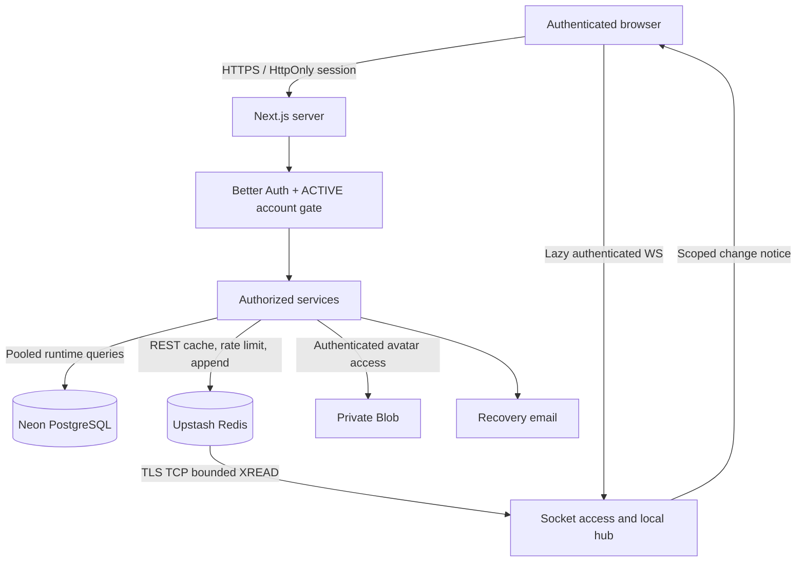
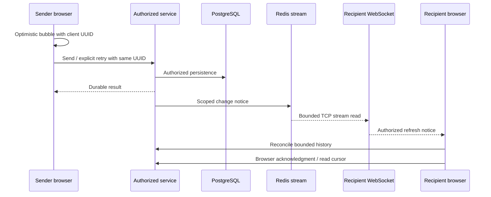

# IMS Network architecture — Phase 22 baseline

Protected Preview is user-accepted. Production readiness and CI execution are separate gates. See ADRs for historical decisions.

## Components and trust boundaries

The durable database stores membership, profiles, conversations, messages, read cursors, delivery acknowledgments and moderation records. Requests derive identity from server sessions. Admin approval remains required; email verification no longer gates registration. Legacy UNVERIFIED state is retained for compatibility. The review-only moderator capability is separate from ADMIN, controlled by the owner. Private message bodies are not exposed to reviewers.

React request-scoped cache deduplicates page-account reads within a render only. Member detail cache uses a profile revision and fresh ACTIVE checks. Cache misses and failures have explicit behavior; authorization is not bypassed. Lists are bounded and paginated. Avatars use the existing authenticated endpoint. PWA service worker does not store private responses offline.

## Message lifecycle

Publication is best effort; persisted messages survive relay failure. Reconciliation handles missed notices. The compatible RESP2 TCP adapter uses TLS verification and explicit connection options. No global socket or idle presence heartbeat. Typing and activity are opt-in, conversation-scoped and expire for display. Read receipts reflect stored cursor; delivery means browser acknowledgment, not all-device guarantee.

## Environment separation

Development, protected Preview and future Production must have independently verified database targets and Redis isolation. Preview has nine recorded migrations as reported by the maintainer. Production begins with a fresh database unless a legitimate legacy export becomes available. Direct SQL migration credentials and pooled runtime credentials have distinct roles. Runtime Frankfurt routing was observed for the diagnostic WebSocket invocation; verify new deployments. Build region may differ. Git-triggered Vercel deploys remain disabled.

## Related references

[Data model](../data-model.md), [avatar storage](../avatar-storage.md), [community upgrade](../phase22-community-upgrade.md), [performance baseline](../phase21fg-performance.md), [release runbook](../phase23-release-runbook.md).
